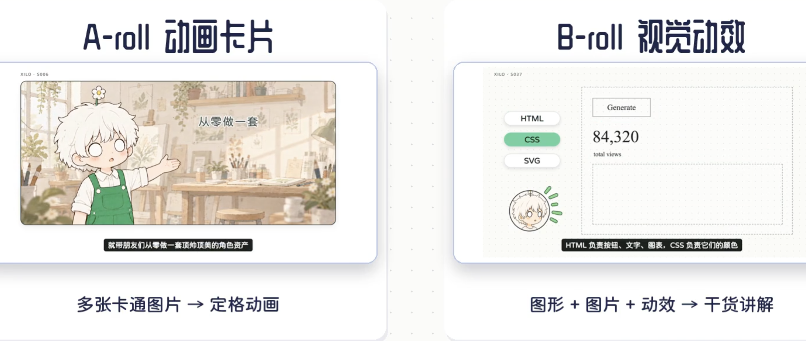

# A/B-roll 叙事与动作设计

用于分镜、动作设计和画面修订。目标是区分内容层次，并让两类画面各自承担清楚的任务。

## 用户参考与适用范围



参考左侧是“多张卡通图片组成定格动画”，右侧是“图形、图片与动效联动讲解”。这张静态图提供分工与构成参考，具体动作节奏要在实际镜头中验证。当前角色、A-roll 白底和 B-roll 浅灰手绘配色仍按本包规范执行；图中的彩色人物、室内背景、圆角大框和阴影属于参考的具体画风。

## 按文案作用选择画面

| 类型 | 主要承担的内容 | 画面要完成的任务 | 验收重点 |
|---|---|---|---|
| A-roll 动画卡片 | 开场代入、生活处境、经历、情绪、吐槽、铺垫、段落衔接 | 让人物经历一件小事，形成可读的行动、反应或结果 | 观众能看懂人物遇到什么、做了什么、发生什么变化 |
| B-roll 视觉动效 | 概念、方法、步骤、机制、证据、比较、数据与结论依据 | 让对象、图像及关系随讲解变化，把抽象知识变成看得见的过程 | 观众能指出画面怎样解释本段知识，而非只读到同义文字 |

以完整语义段落判断。生活故事中出现需要解释的机制时，可从人物正在操作的对象进入 B-roll；讲解结束可回到人物使用结果的场景。单个词、句子长度和字幕换屏不决定 A/B。混合段落按主要任务组织，确有任务切换才在真实语义边界拆镜；保留已确认的配音和时间轴。不为画面丰富硬凑比例，也不要求机械交替。

铺垫和衔接有叙事作用：A-roll 应让它们更具体、有趣，并为接下来的知识提出问题。B-roll 根据解释需要组合图形、图片与动效，单个镜头可只用其中合适的部分。

## 分镜先写清动作

沿用飞书九列表。在“画面设计”中写本镜作用、观众要理解的一句话、主体与最终结果；在“动态变化”中按口播写“锚点短语 → 哪个对象怎样变化 → 观众获得什么理解”。A-roll 用动作状态表、B-roll 用元素与动作记录承接细节，无需另造一套重复表格。

可用以下格式检查设计是否具体：

```text
本镜作用：铺垫 / 代入 / 衔接 / 解释 / 证据 / 结论
理解目标：观众看完能理解的一句话
动作链：起始状态 → 对象的行动或关系变化 → 结果状态
口播锚点：引自当前定稿的短语；有配音时再绑定实测时间
承接对象：上一镜留下、或下一镜接走的角色 / 物件 / 图形
```

“卡片淡入、图标放大、文字弹出”只描述入场。继续写到对象做了什么、关系发生什么变化。例如“资料卡进入筛选区，不相关项退开，相关项移到问题旁，形成来源与问题的对应”。

## A-roll：把动作状态组织成一段小戏

1. 先确定人物的处境和当下意图，再设计行动，以及阻力、反应或结果。按表达需要选关键状态，不强凑固定张数或每个阶段。
2. 人物与物件要相互作用。用翻找、搬运、尝试、卡住、接住、整理等具体动作表现意思；姿态和视线跟随手里的事变化。趣味来自成立的处境、夸张的物件关系或可读的反差。
3. 场景只保留让行动成立的环境支点，如桌面、柜子、门或一叠纸。让主物件的位置、数量和状态形成连续线索；镜头稳定，观众才能察觉动作变化。
4. 多张独立状态图按真实口播切换并停留，用定格节奏呈现准备、行动和反应。必要的局部移动用于补清动作；整图缩放、漂浮和随机抖动不计作场景演绎。
5. 结果留出看清的时间，再通过物件、动作方向或意义进入下一镜。动作还没读清时先精简内容或重排状态，不增加装饰性变化填时长。

生图使用[角色与动作接口](aroll-ian.md)。Ian 的身份和视觉 DNA 用于统一图像；文章插图中的结构类型、流程图和标注数量仅作候选，视频每张图应只画当前动作状态。避免把整段故事、未来结果或所有说明塞进首张图。

## B-roll：让对象之间发生有意义的联动

从“要解释哪种关系”出发选动作。图形负责结构和关系，图片/真实素材负责具体对象与证据，动效负责顺序、作用和变化，文字补充必要的名称、数字与结论。

| 要解释的关系 | 可以采用的动作与联动 |
|---|---|
| 比较 | 把对应对象放到同一尺度或位置，突出相同条件，再改变被比较的部分，保留可读的结果 |
| 步骤或机制 | 同一个输入对象进入下一阶段，在处理节点发生变化，输出保留可追踪的来源或特征 |
| 筛选与聚合 | 候选项进入同一区域，按当前条件分开，保留项汇聚到目标；去向和条件互相对应 |
| 拆解与层级 | 从完整对象拆出当前讲到的部分，保持原位置对应，逐层显示关系，必要时重新合回整体 |
| 因果与反馈 | 在口播说明原因时改变输入或条件，再呈现相应结果；回路有返回对象和明确方向 |
| 真实素材与图解 | 展示正在讲的局部，定位相关区域，再用对应标注或独立示意图解释；保留观众能认出的对应关系 |

保持对象身份、位置或颜色线索，让观众能追踪“谁对谁产生了什么作用”。新信息按[整组随口播出现](broll-editable.md#整组随口播出现)控制，已建立的对象可继续移动、变形或被比较；未来结果及其连线仍在对应锚点前隐藏。真实截图的文字、数据和功能保持原貌，说明性演示使用独立图形，不修改截图来伪造产品行为。

抽象内容可用手绘示意；具体产品、品牌、界面或事实证据使用可靠素材，缺项按素材清单记录。讲解头像提供陪伴与说话状态，知识对象及其变化承担主要讲解。图解中的文字保持简短，避免与字幕重复整句旁白。

真实素材按当前口播中的对象、动作或结果匹配。来自同一个产品的官方演示，不代表与任意一句旁白都有联系；开头尤其要让观众直接看出本期核心能力。挑片时说明该段可见行为如何支持这句讲解；只有画面好看、无法解释关联时换素材或改用成立的图解。

模板只提供可复用的关系骨架。选择前说明该模板将怎样帮助观众理解本段；若只能换标题、数字并依次淡入，继续改写动作或重新设计。对纯清单或单个事实，清晰的逐项呈现可以成立，无需强加无意义的运动。

## 同一主题的编排示例

以下是动作设计示例，无实际音频，不提供时间或声学验证结论。

| 口播作用与示例短语 | 类型 | 画面与动作 | 与下一段的连接 |
|---|---|---|---|
| 代入：“找一份资料，翻了半天” | A-roll | 人物拉开抽屉，纸张散出来；蹲下翻找，手里拿着一张不相干的纸，身体转向旁边仍未翻完的纸堆 | 选取纸堆中的一张作为下一镜主体 |
| 解释：“先筛出和问题相关的资料” | B-roll | 沿用纸张外观，问题作为筛选依据出现；候选资料逐份进入，按口播区分相关与无关项，相关项留在问题旁 | 保留问题与被选中的资料 |
| 解释：“再把有用内容整理到对应位置” | B-roll | 当前资料中的要点被定位，独立要点图形移动到问题下对应位置；连线随当前对应关系建立，最后保留整理结果 | 整理结果收拢成可拿取的一份文件 |
| 衔接：“这回就容易找了” | A-roll | 同一人物从有序位置抽出目标文件，拿到面前，停在结果状态 | 由文件或人物视线进入下一段 |

## 制作和验收

实际制作项目先完成能代表本期难点的 A-roll 与 B-roll 镜头，检查完整动作段后再扩展相同方法。已授权整片时自行检查并连续推进；只请求方案或维护 Skill 时交付相应设计与规则。

- A-roll 看状态序列及换图前后：动作是否成立、反应是否可读、人物与道具是否连续、结果是否有停留。
- B-roll 看解释过程：对象可追踪、知识关系清楚、动作与口播相符；逐项出现正确后，还要核对联动确实帮助理解。
- 连看相邻镜头：场景演绎与知识讲解是否各有作用，是否存在反复使用同一摆姿或相同卡片入场的单调段落。
- 静态图只能检查构图与视觉。动作、节奏、口播对应和编码后效果按[字幕与成片检查](captions-and-delivery.md#叙事与动作检查)分别记录证据。
